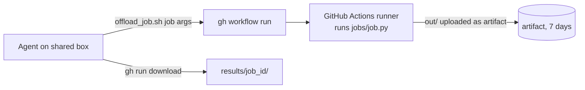

> **This project's home is now [github.com/globe-teck/offload-job-runner](https://github.com/globe-teck/offload-job-runner).** This copy stays up for existing links. Please open issues and pull requests there.

# offload-job-runner

[](https://github.com/leighsrodney-prog/offload-job-runner/actions/workflows/ci.yml)

Run memory-heavy or long jobs on GitHub Actions instead of on a small, shared
agent computer.

AI agents (and the people working with them) often share one modest Linux box.
One 6 GB data job can push everyone else into swap. This repo gives you a
`workflow_dispatch` workflow plus a small helper script: you name a job, it runs
on a fresh GitHub-hosted runner, and the results come back to a local folder.



## Why

- **Protect the shared box.** A simple rule works well: if a job is expected to
  need more than about **2 GB of memory** or run longer than about **30
  minutes**, run it off-box.
- **Clean, repeatable runs.** Every job starts on a fresh runner (about 16 GB RAM,
  4 vCPUs on standard Linux runners for public repos; 7 GB / 2 vCPUs on private
  ones).
- **Nothing to host.** No servers, queues or keys beyond your existing `gh` login.
- **A record for free.** Each run has a URL, a log, and a `_run_meta.json` with
  exit code, wall time and peak memory.
- **Measure, don't guess.** Each run records peak resident memory (`/usr/bin/time -v`) and wall time, so you can size jobs from data before deciding where they run.

## Setup

Requires the [GitHub CLI](https://cli.github.com/) (`gh`), logged in with
access to run workflows on your runner repo, plus `bash`.

1. Create a repo from this one (public or private) and push it to GitHub.
2. Add your jobs as `jobs/<name>.py`. Each job must write its output to `out/`.
   Optional dependencies go in `jobs/requirements.txt`.
3. On the shared box, point the helper at your repo:

```bash
export OFFLOAD_REPO=<owner>/<repo>
export OFFLOAD_RESULTS_DIR=~/offload-results   # optional, default ./results
```

## Usage

```bash
./offload_job.sh sample_heavy "--gb 3"
```

Output:

```text
dispatched job=sample_heavy job_id=sample_heavy-20261020-232957-10073
run: https://github.com/<owner>/<repo>/actions/runs/<run_id>
status=success artifact_download=ok path=./results/sample_heavy-20261020-232957-10073
{"job":"sample_heavy","job_id":"...","exit_code":0,"wall_seconds":9,"max_rss_kb":3200000}
```

The script exits 0 only if the run succeeded **and** the artifact downloaded.
The results folder holds everything the job wrote to `out/`, plus `_log.txt`
(stdout/stderr), `_time.txt` and `_run_meta.json`.

Exit codes: `2` bad job name, `3` run not found after dispatch, `1` run failed
or download failed.

## How it works

- The helper generates a unique `job_id` and passes it to the workflow, whose
  `run-name` includes `[job_id]`. That lets the helper find its own run even when
  several are dispatched at once.
- The workflow validates the job name (`a-z0-9_-`) and job id, then runs
  `python jobs/<job>.py <args>`. Arguments are split on whitespace and are never
  passed through `eval`.
- `out/` is uploaded as artifact `result-<job_id>` with 7-day retention, even if
  the job fails.

## Limits

- **Free minutes.** Public repos get standard GitHub-hosted runners free.
  Private repos draw on your plan's included minutes (2,000/month on GitHub
  Free at the time of writing); check your billing page before offloading
  lots of work.
- **Time.** The workflow caps a job at 300 minutes; GitHub's hard limit is 6
  hours per job. Longer work needs a different machine.
- **Memory.** Standard runners have a fixed memory size. Bigger needs larger
  (paid) runners or a self-hosted runner.
- **Inputs.** Jobs see only what is in the repo, what they download, and
  encrypted secrets. Don't commit private data, and remember that logs and
  artifacts of a public repo are public.
- **Artifacts** expire after 7 days. Copy anything you want to keep.

## Security notes

- The helper uses your existing `gh` authentication and never prints tokens.
  Don't add debug output (such as `set -x`) that might.
- The workflow runs with `contents: read` permissions only.
- Treat job output as data. Review it before acting on it.

## Tests

```bash
python3 -m unittest discover -s tests -v
shellcheck offload_job.sh
```

The tests need no network. The `ci` workflow runs both on every push.

What was tested: the 3 unit tests plus 1 live run. Unit tests cover the sample job and the helper's input checks. Dispatch, run lookup and artifact download were verified with a live run on a test repo.

## Authorship

Built with AI coding assistance. I defined the requirements, ran the tests, and reviewed the changes.

## License

MIT. See [LICENSE](LICENSE).
